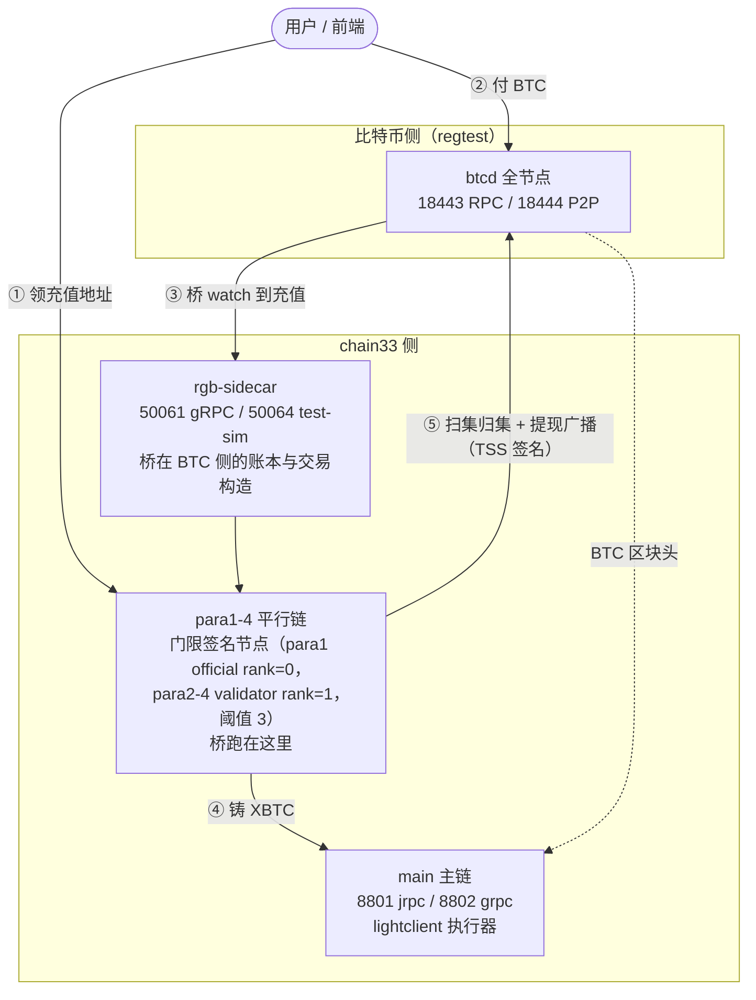

# BTC 跨链演示环境 · 部署与对接手册

> **代码仓库**：https://github.com/bysomeone/plugin （公开 fork，无需额外授权）
> **交付分支**：`demo/btc-crosschain`
>
> 读者：需要把整套 BTC 跨链系统跑起来、并对接前端做演示的工程师。

## 一、这是什么

**一条命令在本地拉起一整套跨链网络**，然后完整演示「用户付 BTC → 链上到账 → 用户之间转账 → 提现回 BTC」。

环境包含这些服务：

| 服务 | 角色 |
|---|---|
| `main` | chain33 主链 |
| `para1-4` | 4 条平行链，跨链桥与门限签名节点 |
| `btcd` | 比特币全节点（regtest） |
| `rgb-sidecar` | 桥在比特币侧的账本与交易构造 |

比喻：相当于把交易所的出入金系统整个塞进一台笔记本 —— 比特币链是真实的一条链（regtest，块自己挖），chain33 是记账那条链，中间那座桥由 4 个节点用门限签名共同掌管。

## 二、环境拓扑



要点：

- **桥跑在平行链上**（`para1-4` 的 `[rpc.sub.light]`），不在主链。主链只跑 lightclient 执行器，做 BTC 区块头的共识校验。
- **每个用户一个专属充值地址**：按 `P2WSH(chain33地址, TSS群公钥)` 派生，链上按同一份派生认定归属。

## 三、对外端口

| 服务 | 端口 | 用途 | 给谁 |
|---|---|---|---|
| main | `8801` | chain33 JSON-RPC | 前端 / CLI |
| main | `8802` | chain33 gRPC | 前端 |
| para1 | `17001` | **充值地址发放接口（HTTP）** | 前端 |
| para1 | `17000` | RGB consignment 监听 | 一般不直连 |
| btcd | `18443` | 比特币 RPC（regtest；用户 `root` / 密码 `1314`） | 演示脚本挖块、付款 |
| btcd | `18444` | 比特币 P2P | — |
| rgb-sidecar | `50061` | 侧车 gRPC | 调试 |
| rgb-sidecar | `50064` | test-sim（仅 regtest） | 演示脚本 |

## 四、前置条件与首次启动

- **Docker Desktop**（建议 ≥ 8 核 / 16 GB 内存 / 20 GB 空闲磁盘）
- **Go 1.23**

首次启动会编译 chain33 与侧车，约 **10–20 分钟**；之后走 Docker 层缓存，几十秒。

## 五、起 / 停

```bash
# 起环境（首次含编译）
make docker-compose proj=up dapp=rgbx

# 停（保留容器与数据卷，下次原地继续）
make docker-compose-down proj=down dapp=rgbx
```

起来后核对：`docker compose -p rgbx ps` 里 `main`、`btcd` 应为 `healthy`，其余为 `Up`。

`proj=` 后面是动作名：`up`（只起环境）、`run`（起环境 + 跑全部用例）、`down`、`reset`、`test`。

## 六、测试账号与地址

以下都是 regtest 的固定测试凭据，**仅用于本地演示**（它们本来就写在 `docker-compose.sh` 里）。

| 用途 | 地址 | 私钥 |
|---|---|---|
| 演示用户（chain33 侧收款地址） | `14KEKbYtKKQm4wMthSK9J4La4nAiidGozt` | — |
| 主链账户 1（演示主账户） | `1KSBd17H7ZK8iT37aJztFB22XGwsPTdwE4` | `0x6da92a63…a81b` |
| 主链账户 2 | `1JRNjdEqp4LJ5fqycUBm9ayCKSeeskgMKR` | `0x19c06923…fee4` |
| 主链账户 3 | `1NLHPEcbTWWxxU3dGUZBhayjrCHD3psX7k` | `0x7a80a1f7…f115` |
| 主链账户 4 | `1MCftFynyvG2F4ED5mdHYgziDxx6vDrScs` | `0xcacb1f5d…6b71` |
| 签名私钥（`-k` 用） | — | `CC38546E…6944` |
| BTC 提现收款地址（regtest） | `bcrt1qnnwpfpljh5n8m3a8xtf3x5ayvhjjplxmhuexyh` | — |
| btcd RPC | `127.0.0.1:18443`，`root` / `1314` | — |

完整私钥见 `docker-compose.sh` 顶部的 `AUTH_KEY1-4` / `GENESIS_KEY`。

**充值地址不是固定的**：每个用户一个，向桥索取（见 §七 步骤 ①）。它与 chain33 地址一一对应，付到这个地址的 BTC 就归属该 chain33 地址。

## 七、完整流程：前端接口 ↔ 等价 CLI

### 充值

| # | 动作 | 接口 | 等价 CLI / 命令 |
|---|---|---|---|
| ① | 领该用户的充值地址 | `GET` 或 `POST http://<para1>:17001/rgbx/v1/btc-deposit-address`，参数 `chain33Addr=<用户chain33地址>` | 无（纯 HTTP） |
| ② | 用户付 BTC 到该地址 | 用户自己的 BTC 钱包；演示环境可用 btcd RPC 造交易 | `chain33-cli rgbx btcDepositTx …`（harness 内部用） |
| ③ | 查到账余额 | chain33 jrpc：`asset balance` | `chain33-cli asset balance -a <用户地址> --asset_exec=rgbx --asset_symbol=XBTC` |
| ④ | 查跨链信息（TSS 公钥 / 主池地址） | chain33 jrpc：`rgbx getCrossChainInfo` | `chain33-cli rgbx getCrossChainInfo -s BTC` |
| ⑤ | 扫集（归集回主池） | **桥自动**（空闲 ticker），无需前端调用 | — |

**① 的返回**：

```json
{"data":{"address":"bcrt1q…","pkScript":"…","userID":"…","spec":"P2WSHDepositSpecV1","watchSize":1}}
```

- **幂等**：同一用户重复请求返回同一地址，watch 集不增长。
- 缺参数 / 非法地址 → `400`；方法不对 → `405`。
- 这是**写操作**：桥从这一刻开始 watch 该地址，所以地址必须向桥索取，不要自己推导。

链上记账符号是 **`XBTC`**（源资产符号 `BTC`，前缀 `X` 由主链配置项 `crossChainAssetPrefix` 决定）。

### 链上流转

用户之间在 chain33 上转 XBTC —— 纯链上动作，不涉及 BTC 侧。

| # | 动作 | 接口 | 等价 CLI |
|---|---|---|---|
| ① | 转账 | chain33 jrpc：`rgbx transfer` | `chain33-cli send rgbx transfer -a <金额> -s XBTC -t <收款chain33地址> -k <私钥>` |
| ② | 查余额 | chain33 jrpc：`asset balance` | `chain33-cli asset balance -a <地址> --asset_exec=rgbx --asset_symbol=XBTC` |

> 符号写法：`transfer` 用 **`XBTC`**，`withdraw` 用 **`BTC`**。按各自命令抄即可。

### 提现

| # | 动作 | 接口 | 等价 CLI |
|---|---|---|---|
| ① | 发起提现 | chain33 jrpc：`rgbx withdraw` | `chain33-cli send rgbx withdraw -a <金额> -f <费率 sat/vB> -d <收款BTC地址> -s BTC -k <私钥>` |
| ② | 查提现进度 | chain33 jrpc：`rgbx listPendingTx` | `chain33-cli rgbx listPendingTx -s 0 -i 0 -c 20` |
| ③ | 广播到 BTC、确认、销毁 | **桥自动**（TSS 签名 → 广播 → 确认 → 链上销毁） | — |

### 前端用 jrpc 时的三步链

`chain33-cli send …` 内部是三步，自己拼 jrpc 要照同一条链走：

1. `Chain33.CreateTransaction`（`execer=rgbx`、`actionName` 取对应动作）
2. `Chain33.SignRawTx`（用户私钥）
3. `Chain33.SendTransaction`

## 八、已知限制

1. **演示范围是 BTC 跨链**：本分支的场景集覆盖充值 / 扫集 / 链上流转 / 提现 / BTC 头链护栏，不含 USDT 相关用例。要跑完整套件：`RGBX_BTC_ONLY=0 make docker-compose proj=run dapp=rgbx`。
2. **regtest 环境**：比特币是本地私链，块要自己挖；金额、确认数都是演示口径，不是生产参数。
3. **`testSignPsbt` 在 regtest 下打开**（para toml）：该端点等于「用组私钥签任意内容」，生产必须关。
4. **TSS share 与侧车账本不可再生**（丢了就永久失去签名能力）。演示环境可以整环境重建；按这个架构上生产前必须先落地备份方案（见 `BACKUP_RECOVERY.md`）。
5. **测试私钥在公开仓库里**，只适用于 regtest，**不要用到 testnet / mainnet**。

## 九、排障

| 症状 | 先看什么 |
|---|---|
| `para1-4` 起来就退出 | 日志搜 `refuse to start` |
| 充值不到账 | 地址是不是向桥要的、确认数够不够、`docker compose -p rgbx ps` 里服务是否都在 |
| 提现卡住 | `rgbx listPendingTx` 看 pending；`para1` 日志搜 `withdraw` |
| 余额不涨 | 符号是不是写成了 `BTC`（应为 `XBTC`） |

```bash
docker logs --tail=200 rgbx-para1-1          # 桥在平行链上
docker logs --tail=200 rgbx-main-1           # 主链 / lightclient 执行器
docker logs --tail=200 rgbx-rgb-sidecar-1    # 侧车
```

## 十、相关文档

- `plugin/dapp/lightclient/rpc/lightclient/neutrino/CONFIG.md` —— 桥的配置项全表
- `plugin/dapp/lightclient/rpc/lightclient/neutrino/BACKUP_RECOVERY.md` —— 备份/恢复
- `plugin/dapp/rgbx/cmd/ci/docker-compose.sh` —— 本环境的编排脚本
